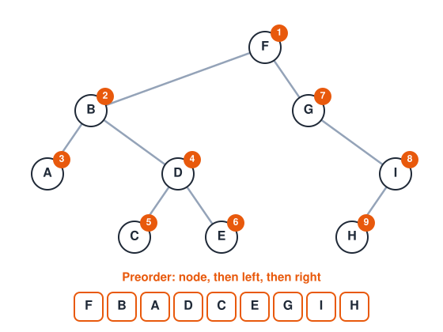

# Preorder traversal

> **Node first, then the left subtree, then the right subtree.**
>
> Before reading this, I make sure Levels 0 to 3 of the [family course](../README.md) are clear: tree vocabulary, recursion, and the three depth-first orders.

---

## 1. The intuition

Think of the table of contents of a book:

```text
1. Trees
   1.1 Vocabulary
   1.2 Binary trees
2. Graphs
   2.1 ...
```

The title of a chapter is written **before** its sections, and a section's title is written **before** its subsections. Every "parent" is announced before its "children". That is exactly preorder.

Another picture: a manager introducing their team at a meeting. They say their own name first, then hand over to their first team lead, who introduces themself and then their own team, and so on. Only when the first team is completely done does the second team lead speak.

---

## 2. The rule

At every node, in this order:

1. **write down** the node,
2. traverse its **left** subtree completely (in preorder),
3. traverse its **right** subtree completely (in preorder).



The orange numbers show the visit order: `F B A D C E G I H`.

---

## 3. Step by step

The recursive function is called `visit`. Each line of the table is one moment of the run. The "pile" column is the call stack from the family course: the calls that are not finished yet, from bottom to top.

| Step | I am on | Action | Written so far | Pile of unfinished calls |
| --- | --- | --- | --- | --- |
| 1 | F | write F, go left | `F` | F |
| 2 | B | write B, go left | `F B` | F B |
| 3 | A | write A. Left and right are empty: done | `F B A` | F B A |
| 4 | B | back on B, go right | | F B |
| 5 | D | write D, go left | `F B A D` | F B D |
| 6 | C | write C, it is a leaf: done | `F B A D C` | F B D C |
| 7 | E | back on D, go right: write E, leaf: done | `F B A D C E` | F B D E |
| 8 | F | D is done, B is done: back on F, go right | | F |
| 9 | G | write G. Left is empty, go right | `F B A D C E G` | F G |
| 10 | I | write I, go left | `… G I` | F G I |
| 11 | H | write H, leaf: done | `… G I H` | F G I H |
| 12 | | everything finishes, the pile empties | `F B A D C E G I H` | |

---

## 4. The recursive version

In plain words:

```text
preorder(node):
    if node is empty:
        return an empty list
    return [node's value] + preorder(node.left) + preorder(node.right)
```

That is the whole algorithm. The base case (`node is empty`) stops the recursion at the bottom of every branch.

> **A small performance note.** `list_a + list_b` builds a new list each time, which copies values over and over. A cleaner way is to create one result list and pass it down, or to define a small inner function that does `result.append(value)`. Both give the same answer; the second avoids the copies.

---

## 5. The iterative version (with my own stack)

Recursion uses Python's call stack, which is limited to about 1,000 levels. To handle very deep trees, I manage a stack myself, with a plain Python list: `append()` puts a node on top, `pop()` takes the top one off.

```text
preorder_iterative(root):
    if root is empty: return []
    stack = [root]
    result = []
    while the stack is not empty:
        node = take the top of the stack
        write node's value into result
        if node has a right child: put it on the stack
        if node has a left child:  put it on the stack
    return result
```

**Why the right child goes on the stack before the left one?** A stack gives back the **last** thing put on it. I want the left child to come out first, so it must go in last.

Trace on the sample tree (top of the stack on the right):

| Take | Write | Stack after pushing the children |
| --- | --- | --- |
| | | `[F]` |
| F | F | `[G, B]` |
| B | B | `[G, D, A]` |
| A | A | `[G, D]` |
| D | D | `[G, E, C]` |
| C | C | `[G, E]` |
| E | E | `[G]` |
| G | G | `[I]` |
| I | I | `[H]` |
| H | H | `[]` |

Result: `F B A D C E G I H`, the same as the recursive version.

---

## 6. Complexity

`n` is the number of nodes, `h` is the height of the tree (see Level 5 of the family course).

| | Cost | Why |
| --- | --- | --- |
| Time | `O(n)` | Each node is written once and pushed / popped once. |
| Extra memory, recursive | `O(h)` | One unfinished call per level on the way down. |
| Extra memory, iterative | `O(h)` | The stack holds at most about one waiting right child per level, plus the current branch. |

On a balanced tree `h` is about `log₂(n)`; on a degenerate tree `h = n`.

---

## 7. Where preorder is used in real life

- **Copying a tree, or saving it to a file.** To rebuild a tree, the parent must exist before its children can be attached to it. Writing the nodes in preorder (with a marker for empty children) is a classic way to save a tree and load it back.
- **Showing a folder hierarchy.** The `tree` command on Linux and every file explorer print a folder's name, then its content, indented below it.
- **Tables of contents, nested menus, outlines.** Any "title, then its sub-items" display.
- **Web pages.** A web page is a tree of elements called the DOM (*Document Object Model*). Searching it with `document.querySelectorAll` returns the elements in preorder, which is also the order they appear in the page's source.
- **Prefix notation.** Reading an expression tree in preorder gives the calculation in prefix (Polish) notation: `* + 3 4 - 5 2`. Lisp-family languages write code this way.

---

## 8. Common mistakes

- **Forgetting the base case.** Without `if node is None`, the code crashes with `AttributeError: 'NoneType' object has no attribute 'left'` on the first leaf.
- **Pushing left before right in the iterative version.** The result comes out as node, right, left: a mirror image.
- **Returning `None` instead of `[]` for the empty tree.** Then `[value] + preorder(None)` fails.

---

## 9. Checkpoint

1. Give the preorder of this tree:
   ```text
         10
        /  \
       5    20
        \   / \
         7 15  30
   ```
2. In the iterative version, what goes wrong if I push the left child first?
3. Why is preorder the natural order to *copy* a tree?

<details><summary>Answers</summary>

1. `10 5 7 20 15 30`.
2. The right child comes out of the stack first, so I get node, right, left.
3. Because each node is created before its children, so there is always a parent ready to attach them to.
</details>

---

## 10. Exercises

Open [preorder.py](preorder.py) and implement:

| Function | What it does |
| --- | --- |
| `preorder(root)` | Recursive preorder, returns a list of values. |
| `preorder_iterative(root)` | Same result with my own stack. Must handle a tree 10,000 levels deep. |
| `to_prefix(root)` | Writes an expression tree in prefix notation: `"* + 3 4 - 5 2"`. |

Then run, from the `Python/` folder:

```bash
pytest -k preorder
```
