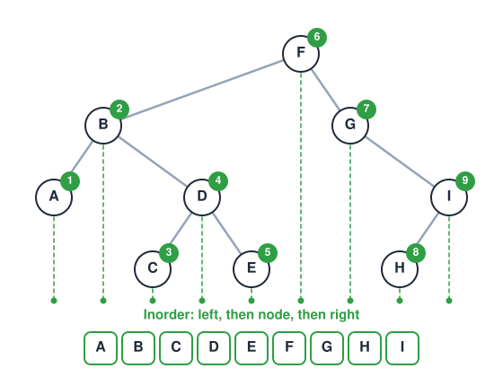

# Inorder traversal

> **Left subtree first, then the node, then the right subtree.**
>
> Before reading this, I make sure Levels 0 to 3 of the [family course](../README.md) are clear, and I have done [preorder](../01_preorder/) first.

---

## 1. The intuition

Look at the sample tree from far away, with the sun exactly above it. Every node casts a shadow straight down onto the ground. Read the shadows from left to right: that is the inorder traversal.



Why does it work? Because in a drawing of a binary tree, everything in the **left** subtree of a node is drawn **to its left**, and everything in its right subtree is drawn to its right. "Left subtree, then node, then right subtree" is just "read from left to right".

And here the shadows come out in **alphabetical order**: `A B C D E F G H I`. That is not luck. This tree is a *binary search tree*, and inorder is what makes those trees useful (section 7).

---

## 2. The rule

At every node, in this order:

1. traverse its **left** subtree completely (in inorder),
2. **write down** the node,
3. traverse its **right** subtree completely (in inorder).

The first node written is therefore **not** the root: it is the node reached by going left as long as possible (A).

---

## 3. Step by step

| Step | I am on | Action | Written so far | Pile of unfinished calls |
| --- | --- | --- | --- | --- |
| 1 | F | go left first | | F |
| 2 | B | go left first | | F B |
| 3 | A | left is empty: write A. Right is empty: done | `A` | F B A |
| 4 | B | left is done: write B, go right | `A B` | F B |
| 5 | D | go left first | | F B D |
| 6 | C | write C, leaf: done | `A B C` | F B D C |
| 7 | D | left is done: write D, go right | `A B C D` | F B D |
| 8 | E | write E, leaf: done | `A B C D E` | F B D E |
| 9 | F | B is finished: write F, go right | `… E F` | F |
| 10 | G | left is empty: write G, go right | `… F G` | F G |
| 11 | I | go left first | | F G I |
| 12 | H | write H, leaf: done | `… G H` | F G I H |
| 13 | I | left is done: write I. Right is empty | `… H I` | F G I |
| 14 | | everything finishes | `A B C D E F G H I` | |

---

## 4. The recursive version

```text
inorder(node):
    if node is empty:
        return an empty list
    return inorder(node.left) + [node's value] + inorder(node.right)
```

Compared with preorder, a single thing moved: the node's value.

---

## 5. The iterative version

This one is a bit harder than preorder, because a node is **not** written when I first meet it: I must first go down its whole left side, and only write it on the way back.

The idea: "slide down the left side, putting every node on the stack; when I can't go further left, take the top node, write it, and jump once to the right."

```text
inorder_iterative(root):
    stack = []
    result = []
    current = root
    while current is not empty OR the stack is not empty:
        while current is not empty:          # slide down the left side
            put current on the stack
            current = current.left
        current = take the top of the stack  # the leftmost node not written yet
        write current's value into result
        current = current.right              # then explore its right subtree
    return result
```

Trace on the sample tree (top of the stack on the right):

| Slide left, stacking | Take & write | Then go to | Stack after |
| --- | --- | --- | --- |
| F, B, A | A | A.right = empty | `[F, B]` |
| (nothing) | B | D | `[F]` |
| D, C | C | C.right = empty | `[F, D]` |
| (nothing) | D | E | `[F]` |
| E | E | empty | `[F]` |
| (nothing) | F | G | `[]` |
| G | G | I | `[]` |
| I, H | H | empty | `[I]` |
| (nothing) | I | empty | `[]` |

Result: `A B C D E F G H I`.

---

## 6. Complexity

| | Cost | Why |
| --- | --- | --- |
| Time | `O(n)` | Each node goes on the stack once and comes off once. |
| Extra memory | `O(h)` | The stack holds at most the nodes of one path from the root down. |

---

## 7. Where inorder is used in real life

### Binary search trees

A **binary search tree** (often shortened to BST) is a binary tree that respects one rule at **every** node:

> everything in the left subtree is **smaller** than the node, everything in the right subtree is **larger**.

Check it on the sample tree: everything left of F (A, B, C, D, E) comes before F in the alphabet, everything right of F (G, H, I) comes after. The same holds at B, at D, at G, at I.

Because of that rule, the inorder traversal of a binary search tree **always gives the values sorted**. And the other way round: if the inorder traversal is sorted, the tree is a binary search tree. That gives a simple way to check a tree (exercise `is_binary_search_tree`).

Binary search trees, and their balanced cousins (red-black trees, B-trees), are everywhere:

- **Sorted collections.** Java's `TreeMap`, C++'s `std::map` and `std::set` are balanced binary search trees. Looping over them is an inorder traversal, which is why they come out sorted.
- **Databases.** Indexes in PostgreSQL, MySQL or SQLite are B-trees (a family of search trees with many children per node). A query like "all orders between March and June" finds March, then walks the index in order.
- **Filesystems.** Btrfs, a Linux filesystem whose name comes from "B-tree", stores everything in B-trees to keep entries sorted and fast to search.

### Infix notation

Reading an expression tree in inorder gives the usual school notation, `3 + 4 * ...`. But inorder alone **loses information**: the trees of `(3 + 4) * 2` and `3 + (4 * 2)` give the same sequence `3 + 4 * 2`. That is why infix is the only notation that needs **parentheses**, and why the exercise `to_infix` wraps every operation in them: `((3 + 4) * (5 - 2))`.

---

## 8. Common mistakes

- **Checking only parent and child for the search tree rule.** In the tree below, every parent/child pair looks right (3 < 5, 6 > 3, 8 > 5), but 6 sits in the *left* subtree of 5 while being larger than 5. The rule is about **whole subtrees**. Comparing the inorder result avoids this trap.
  ```text
        5
       / \
      3   8
       \
        6
  ```
- **Infinite loop in the iterative version.** Forgetting `current = current.right` after writing a node means the same node is taken again and again.
- **Allowing duplicates.** In this repository a search tree has strictly increasing values: two equal values are not allowed.

---

## 9. Checkpoint

1. Give the inorder of this tree. Is it a binary search tree?
   ```text
         10
        /  \
       5    20
        \   / \
         7 15  30
   ```
2. In a binary search tree, where is the smallest value? How would I find it without traversing everything?
3. Why do the trees of `(1 + 2) * 3` and `1 + (2 * 3)` give the same inorder sequence?

<details><summary>Answers</summary>

1. `5 7 10 15 20 30`. It is sorted, so yes, it is a binary search tree.
2. At the leftmost node: start from the root and keep going left until there is no left child. It costs `O(h)`, not `O(n)`.
3. Because inorder only writes the tokens left to right. The tree's shape, which says what is computed first, is lost. Parentheses put that information back.
</details>

---

## 10. Exercises

Open [inorder.py](inorder.py) and implement:

| Function | What it does |
| --- | --- |
| `inorder(root)` | Recursive inorder, returns a list of values. |
| `inorder_iterative(root)` | Same result with my own stack. Must handle a tree 10,000 levels deep. |
| `to_infix(root)` | Writes an expression tree with all parentheses: `"((3 + 4) * (5 - 2))"`. |
| `is_binary_search_tree(root)` | `True` if the inorder traversal is strictly increasing. |

Then run, from the `Python/` folder:

```bash
pytest -k inorder
```
