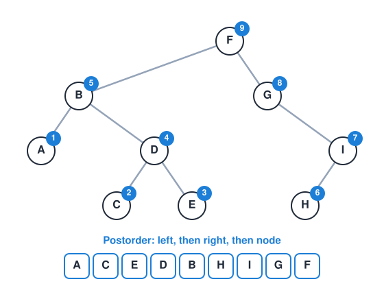
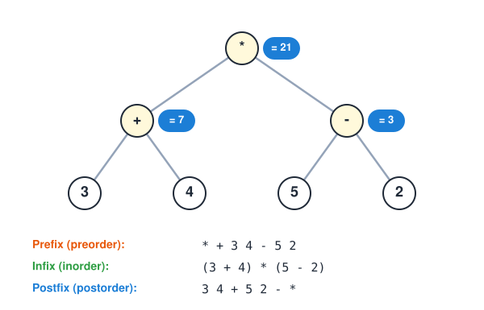

# Postorder traversal

> **Left subtree first, then the right subtree, and the node last.**
>
> Before reading this, I make sure Levels 0 to 3 of the [family course](../README.md) are clear, and I have done [preorder](../01_preorder/) and [inorder](../02_inorder/).

---

## 1. The intuition

A company wants to know its total number of employees. The boss at the top cannot count everyone personally. So they ask each of their direct managers: "How many people in your department?" Each manager asks their own team leads, and so on down to the employees with nobody under them, who simply answer "1, just me".

The answers then climb back up. A team lead adds up the answers of their team, adds 1 for themself, and reports. The boss can only give the final total **at the very end**, once every department has answered.

That is postorder: **a node is handled only after all its children are finished**, because it needs their results.

---

## 2. The rule

At every node, in this order:

1. traverse its **left** subtree completely (in postorder),
2. traverse its **right** subtree completely (in postorder),
3. **write down** the node.



The order is `A C E D B H I G F`: the leaves come out first, and the root **always comes last**.

---

## 3. Step by step

| Step | I am on | Action | Written so far |
| --- | --- | --- | --- |
| 1 | F | go left first | |
| 2 | B | go left first | |
| 3 | A | both sides empty: write A | `A` |
| 4 | B | left done, go right | |
| 5 | D | go left first | |
| 6 | C | leaf: write C | `A C` |
| 7 | D | go right | |
| 8 | E | leaf: write E | `A C E` |
| 9 | D | both sides done: write D | `A C E D` |
| 10 | B | both sides done: write B | `A C E D B` |
| 11 | F | left done, go right | |
| 12 | G | left is empty, go right | |
| 13 | I | go left | |
| 14 | H | leaf: write H | `… B H` |
| 15 | I | left done, right empty: write I | `… H I` |
| 16 | G | both sides done: write G | `… I G` |
| 17 | F | both sides done: write F | `A C E D B H I G F` |

---

## 4. The recursive version

```text
postorder(node):
    if node is empty:
        return an empty list
    return postorder(node.left) + postorder(node.right) + [node's value]
```

The real power of postorder is not the list of values, it is the pattern **"ask the children, then combine their answers"**:

```text
solve(node):
    if node is empty: return the answer for "nothing"
    left_answer  = solve(node.left)
    right_answer = solve(node.right)
    return combine(node, left_answer, right_answer)
```

Two exercises use exactly this pattern:

- **`height`**: the height of an empty tree is 0. Otherwise it is `1 + the larger of the two children's heights`.
- **`evaluate`**: a leaf is worth its number. An operator node is worth `left_value (operator) right_value`.



The blue labels appear in postorder: `+` is worth 7 once 3 and 4 are known, `-` is worth 3 once 5 and 2 are known, and only then `*` can be worth 21.

---

## 5. The iterative version

Postorder is the hardest of the three to write without recursion, because a node is written only on its **third** visit (after both subtrees). Here is a neat trick that avoids that difficulty.

**The mirror trick.** Look at these two orders:

- postorder is: left, right, node,
- read it backwards: node, right, left.

"Node, right, left" is just **preorder with left and right swapped**, and preorder is easy to do with a stack (see the [preorder course](../01_preorder/)). So:

```text
postorder_iterative(root):
    if root is empty: return []
    stack = [root]
    result = []
    while the stack is not empty:
        node = take the top of the stack
        write node's value into result
        if node has a left child:  put it on the stack    # left first,
        if node has a right child: put it on the stack    # so right comes out first
    return result reversed
```

Trace on the sample tree:

| Take | Write | Stack after |
| --- | --- | --- |
| | | `[F]` |
| F | F | `[B, G]` |
| G | G | `[B, I]` |
| I | I | `[B, H]` |
| H | H | `[B]` |
| B | B | `[A, D]` |
| D | D | `[A, C, E]` |
| E | E | `[A, C]` |
| C | C | `[A]` |
| A | A | `[]` |

Written: `F G I H B D E C A`. Reversed: `A C E D B H I G F`. That is the postorder.

> There is also a version with a single stack that remembers the last node written, to know whether it is coming back from the right child. It is a good second challenge once the mirror trick works.

---

## 6. Complexity

| | Cost | Why |
| --- | --- | --- |
| Time | `O(n)` | Each node is pushed, popped and written once; reversing the list costs `O(n)` too. |
| Extra memory, recursive | `O(h)` | One unfinished call per level. |
| Extra memory, mirror trick | `O(n)` | The result is reversed at the end, so all values are kept anyway. The stack itself stays small. |

---

## 7. Where postorder is used in real life

- **Folder sizes.** The `du` command on Linux, or "Properties" on a folder in a file explorer: a folder's size is the sum of its content, so every sub-folder must be measured first.
- **Deleting a folder.** `rm -r` must empty a folder before it can remove it. It deletes the files and sub-folders first, then the folder itself.
- **Freeing memory.** In languages where memory is freed by hand, such as C, a tree is destroyed in postorder: free the children before the parent, otherwise the links to the children are lost.
- **Compilers.** A compiler turns source code into a tree of operations, then generates the machine instructions in postorder: to compute `a * (b + c)`, it must first produce the instructions that compute `a` and `b + c`.
- **Postfix notation and calculators.** Reading an expression tree in postorder gives postfix notation (Reverse Polish Notation), `3 4 + 5 2 - *`. It needs no parentheses and is computed with a simple stack: push numbers, and when an operator comes, pop two numbers, apply it, push the result back. HP scientific calculators work this way, as do the Java and Python virtual machines internally.
- **Build systems and dependencies.** Before building a program, every library it depends on must be built first. On a tree of dependencies, that is postorder.

---

## 8. Common mistakes

- **Mixing up subtraction or division order.** In `evaluate`, it is `left - right`, not `right - left`. The test with `(8 - 2) / 4` catches it.
- **Height off by one.** In this repository the height counts **levels**: an empty tree is 0, a single node is 1. Some books count edges instead, and then a single node has height 0. Both exist; the tests here use levels.
- **Forgetting to reverse** in the mirror trick: the output is then "node, right, left".

---

## 9. Checkpoint

1. Give the postorder of this tree:
   ```text
         10
        /  \
       5    20
        \   / \
         7 15  30
   ```
2. Write the expression `(6 / 2) + 1` in postfix notation, then compute it with a stack, step by step.
3. Why can't a folder's size be computed in preorder?

<details><summary>Answers</summary>

1. `7 5 15 30 20 10`.
2. `6 2 / 1 +`. Stack: push 6 → `[6]`, push 2 → `[6, 2]`, `/` pops 2 and 6, pushes 3 → `[3]`, push 1 → `[3, 1]`, `+` pops 1 and 3, pushes 4 → `[4]`. Result 4.
3. Preorder handles the folder first, when none of its content has been measured yet. The total is only known after the children.
</details>

---

## 10. Exercises

Open [postorder.py](postorder.py) and implement:

| Function | What it does |
| --- | --- |
| `postorder(root)` | Recursive postorder, returns a list of values. |
| `postorder_iterative(root)` | Same result without recursion. Must handle a tree 10,000 levels deep. |
| `evaluate(root)` | Computes an expression tree: `expression_tree()` is worth `21`. |
| `height(root)` | Number of levels: `0` for an empty tree, `4` for `sample_tree()`. |

Then run, from the `Python/` folder:

```bash
pytest -k postorder
```
