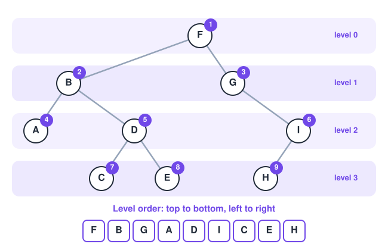

# Level-order traversal (breadth-first on a tree)

> **The root, then everything on level 1, then everything on level 2… each level from left to right.**
>
> Before reading this, I make sure Levels 0, 1 and 4 of the [family course](../README.md) are clear, especially the difference between a queue and a stack.

---

## 1. The intuition

During a fire drill, the security team checks a building **floor by floor**: the whole ground floor first, room by room from left to right, then the whole first floor, then the second… They never go up a floor before the current one is finished.

Or drop a stone in a pond: the ripples spread in circles, the closest circle first, then the next one, then the next. Level order explores a tree like those ripples: **everything at distance 1 from the root, then everything at distance 2**, and so on.



Order: `F B G A D I C E H`.

---

## 2. Why recursion doesn't fit, and what replaces it

The three depth-first orders work by calling themselves on a child, which means **diving down**. Level order must do the opposite: stay on the current level as long as it is not finished.

So I need somewhere to put the nodes I have **discovered but not handled yet**, and they must come out in the **order they arrived**. That is a **queue** (FIFO: *First In, First Out*), like the line at a bakery.

In Python, the right tool is `collections.deque` ("deque" is short for *double-ended queue*, pronounced "deck"):

```python
from collections import deque

queue = deque()
queue.append("x")      # join the back of the line
first = queue.popleft()  # serve the front of the line
```

> **Why not a plain list?** `list.pop(0)` removes the first element, but then Python must shift every other element one place to the left: that costs `O(n)` each time, and the whole traversal becomes `O(n²)`. `deque.popleft()` costs `O(1)`.

---

## 3. The rule

```text
level_order(root):
    if root is empty: return []
    queue = a queue containing only root
    result = []
    while the queue is not empty:
        node = take the front of the queue
        write node's value into result
        if node has a left child:  add it at the back of the queue
        if node has a right child: add it at the back of the queue
    return result
```

---

## 4. Step by step

Front of the queue on the left, back on the right.

| Take from the front | Write | Add at the back | Queue after |
| --- | --- | --- | --- |
| | | | `[F]` |
| F | F | B, G | `[B, G]` |
| B | B | A, D | `[G, A, D]` |
| G | G | I | `[A, D, I]` |
| A | A | (none) | `[D, I]` |
| D | D | C, E | `[I, C, E]` |
| I | I | H | `[C, E, H]` |
| C | C | (none) | `[E, H]` |
| E | E | (none) | `[H]` |
| H | H | (none) | `[]` |

Result: `F B G A D I C E H`.

Look at the queue after G is taken: `[A, D, I]`. That is **exactly level 2**. After I is taken: `[C, E, H]`, **exactly level 3**. That observation is the key to the next section.

---

## 5. Knowing where each level ends

The plain version mixes all levels in one list. Often I need to know **which level** each node is on (to print a tree line by line, for example).

**The trick:** at the moment I start a new level, the queue contains **exactly that level and nothing else**. So I measure the queue's length right then, and take exactly that many nodes out. Their children pile up behind them, and they will form the next level.

```text
levels(root):
    if root is empty: return []
    queue = a queue containing only root
    all_levels = []
    while the queue is not empty:
        size = length of the queue        # number of nodes on this level
        this_level = []
        repeat size times:
            node = take the front of the queue
            add node's value to this_level
            add node's children (left, then right) at the back of the queue
        add this_level to all_levels
    return all_levels
```

On the sample tree: `[['F'], ['B', 'G'], ['A', 'D', 'I'], ['C', 'E', 'H']]`.

With the levels in hand, the exercise **`right_side_view`** becomes easy: standing on the right side of the tree, I only see the **last** node of each level: `F G I H`. Note that a node on the left can be visible, if nothing is to its right on its level.

---

## 6. Complexity

`n` is the number of nodes, `w` is the width of the widest level.

| | Cost | Why |
| --- | --- | --- |
| Time | `O(n)` | Each node enters the queue once and leaves it once, each time in `O(1)` with a `deque`. |
| Extra memory | `O(w)` | The queue holds at most about one level at a time. |

Careful with the memory: in a balanced tree, the last level holds about **half of all the nodes**, so `w` is about `n / 2` and the memory is `O(n)`. Depth-first orders only need `O(log n)` on the same tree. On the other hand, on a degenerate "stick" tree, level order only needs `O(1)` while depth-first needs `O(n)`.

---

## 7. Where level order is used in real life

- **Shortest number of steps.** Because it explores everything at distance 1 before distance 2, the first time level order reaches a node, it has found the **shortest** way to it. Puzzle solvers use this to find a solution in the fewest moves. This is the heart of breadth-first search on graphs, the next family: [BFS](../../02_graph_traversal/01_bfs/).
- **Printing a hierarchy rank by rank.** Organisation charts, family trees by generation, the tournament bracket of a competition round by round.
- **Saving a tree as a flat list.** LeetCode and many tools write a tree like `[F, B, G, A, D, null, I, …]`: that is level order, with `null` for missing children.
- **Heaps.** A binary heap (the structure behind priority queues, used later by Dijkstra's algorithm) is a tree stored in a plain array **in level order**: the children of the element at position `i` sit at `2i + 1` and `2i + 2`.
- **Social networks and the web.** "Friends of friends" suggestions and web crawlers explore what is close first, level by level.

---

## 8. Common mistakes

- **Using `list.pop(0)`.** It works on small examples but makes the algorithm `O(n²)`. Use `deque.popleft()`.
- **Measuring the queue length inside the loop** in `levels`. The length must be read **once**, before taking the level out, because children are added while the level is processed.
- **Adding `None` children to the queue.** Check that a child exists before adding it, or handle `None` when taking it out.

---

## 9. Checkpoint

1. Give the level order and the levels of this tree:
   ```text
         10
        /  \
       5    20
        \   / \
         7 15  30
   ```
2. What is its right side view?
3. What changes if I replace the queue with a stack, and add the right child before the left one?

<details><summary>Answers</summary>

1. Level order `10 5 20 7 15 30`. Levels `[[10], [5, 20], [7, 15, 30]]`.
2. `10 20 30`.
3. It becomes preorder: `10 5 7 20 15 30`. The waiting line decides the strategy: queue for breadth-first, stack for depth-first.
</details>

---

## 10. Exercises

Open [level_order.py](level_order.py) and implement:

| Function | What it does |
| --- | --- |
| `level_order(root)` | All values, level by level, left to right. |
| `levels(root)` | One list per level. |
| `right_side_view(root)` | The last value of each level. |

Then run, from the `Python/` folder:

```bash
pytest -k level_order
```
