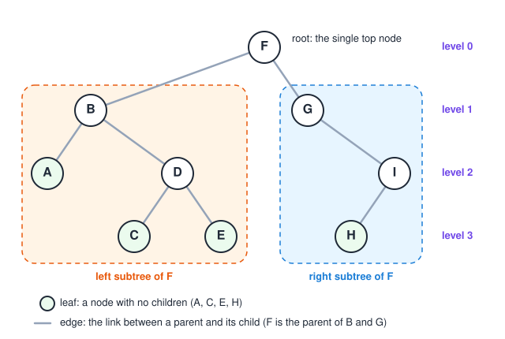
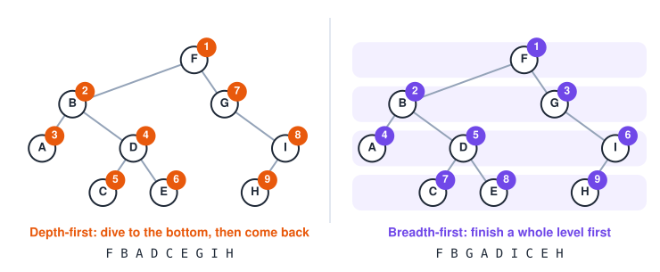
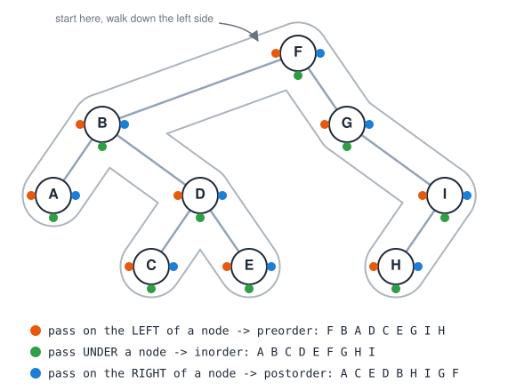
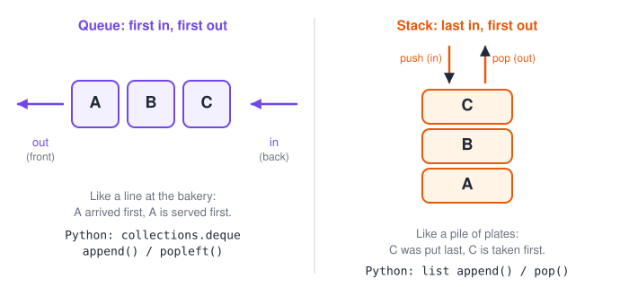
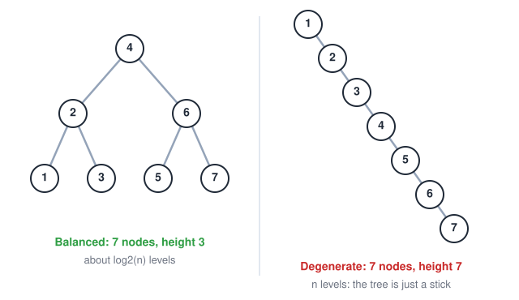
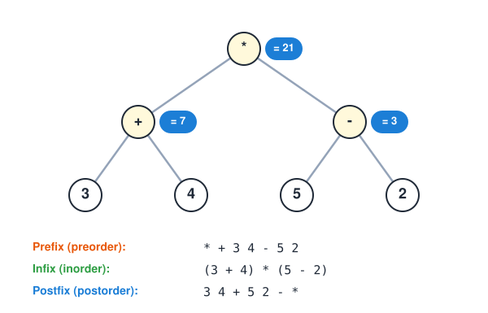

# Tree traversal: the complete course

This folder covers the whole family of **tree traversals**: the four classic ways to visit every node of a binary tree.

| # | Algorithm | In one sentence |
| --- | --- | --- |
| 01 | [Preorder](01_preorder/) | Write the node down **before** visiting its children. |
| 02 | [Inorder](02_inorder/) | Write the node down **between** its left and its right child. |
| 03 | [Postorder](03_postorder/) | Write the node down **after** visiting its children. |
| 04 | [Level order](04_level_order/) | Visit the tree **floor by floor**, from top to bottom. |

This page is the theory shared by all four. Each algorithm then has its own course in its folder, with a step-by-step trace, its real-world uses and the exercises.

The course is built like a staircase. Each level relies only on the levels below it, and ends with a **checkpoint**: a few questions to answer before going up. If a checkpoint feels hard, I reread the level instead of pushing on.

---

## Level 0: What is a tree?

### Start with something I already know

Think about the folders on a computer. There is one main folder at the top. Inside it there are other folders, inside those there are more folders, and at the very bottom there are files that contain nothing else.

Or think about a family tree drawn upside down: one ancestor at the top, their children below, their grandchildren below that.

Both pictures have the same shape: **one starting point at the top, and things that branch downwards, without ever looping back up.** That shape is what computer scientists call a *tree*. They draw it upside down compared to a real tree: the root is at the top, and it grows downwards.

### The vocabulary, one word at a time



- **Node**: one box of the tree (one circle in the drawing). Each node holds a value: here a letter.
- **Edge**: the line that links two nodes.
- **Parent** and **child**: when two nodes are linked, the upper one is the *parent* and the lower one is the *child*. F is the parent of B and G; B and G are the children of F.
- **Root**: the only node with no parent, at the very top (F).
- **Leaf**: a node with no children, at the bottom of a branch (A, C, E, H).
- **Subtree**: pick any node and keep only that node and everything hanging below it. What I get is again a tree. The orange box is the *left subtree* of F, the blue box is its *right subtree*.
- **Level** (or **depth**): how many edges separate a node from the root. F is on level 0, B and G on level 1, and so on.
- **Height**: the number of levels of the tree. This one has 4 levels (0 to 3), so its height is 4.

### Binary trees

In a **binary** tree, every node has **at most two children**, and they are not interchangeable: one is the **left** child, the other is the **right** child. ("Binary" just means "two".)

G has no left child but has a right child, I. That is allowed: a missing child is simply empty.

### What a tree looks like in Python

A tree is never stored "all at once". Each node only knows its value and its two children. Holding the root is enough to reach everything else, the same way holding the top folder is enough to reach every file.

```python
@dataclass
class Node:
    value: Any
    left: Node | None = None   # None means "no child here"
    right: Node | None = None
```

The shared code lives in [binary_tree.py](binary_tree.py). `sample_tree()` builds the tree of the figure above. It is used in every figure, every example and every test of this family, so I can always check my reasoning against a picture.

> **Checkpoint 0**
> 1. In the figure, who is the parent of D? Who are the children of D?
> 2. Name all the leaves.
> 3. How many nodes are in the right subtree of F?
> 4. Can a binary tree node have three children?
>
> <details><summary>Answers</summary>
>
> 1. The parent of D is B. Its children are C (left) and E (right).
> 2. A, C, E and H.
> 3. Three: G, I and H.
> 4. No. Two at most: a left one and a right one.
> </details>

---

## Level 1: What does "traversing" mean?

### The night guard

Picture a night guard in a museum. Every night they must check **every room exactly once**: not skip any, not check the same one twice. Doing the round is *traversing* the museum.

Traversing a tree is the same job: **visit every node exactly once**, and do something with it (print it, add it up, copy it, compare it…).

### Why there is more than one way

With a simple list `[3, 1, 4]` the question does not even come up: I start at the beginning and walk to the end.

A tree **branches**. When I stand on F, I have two ways to go: towards B or towards G. And when I go towards B, I will have to come back to F later to visit G. So I need a **strategy** that decides the order.

There are two big families of strategies.



- **Depth-first** (left): I go **down** as far as I can along one branch, all the way to a leaf. Only when that branch is finished do I come back up and try the next one. It is how I read a book: I finish chapter 1, including all its sections and subsections, before starting chapter 2.
- **Breadth-first** (right): I visit the tree **floor by floor**. First the root, then everybody on level 1, then everybody on level 2… It is how a visitor would tour a building: the whole ground floor, then the whole first floor, and so on.

> **Checkpoint 1**
> 1. What are the two rules every traversal must respect?
> 2. In the depth-first picture, why does G come so late (7th) even though it is right under the root?
>
> <details><summary>Answers</summary>
>
> 1. Every node is visited, and none is visited twice.
> 2. Because depth-first finishes the whole left branch (B, A, D, C, E) before it is allowed to go back up and take the right branch.
> </details>

---

## Level 2: The trick that makes it easy: recursion

### A tree is made of smaller trees

Look again at the anatomy figure. The left subtree of F (the orange box) **is itself a tree**, with B as its root. And the left subtree of B is a tree too, with just A in it.

That means a big problem ("visit the whole tree") can be cut into **the same problem, but smaller** ("visit the left subtree", "visit the right subtree"). A function that solves a problem by calling **itself** on a smaller piece is called a **recursive** function.

### The cinema analogy

I am sitting in a dark cinema and I want to know my row number. I cannot count the rows. So I ask the person in front of me: "Which row are you in?" They don't know either, so they ask the person in front of them, and so on.

The person in the very first row doesn't need to ask anyone: they *know* they are in row 1. That is the **base case**: the case small enough to answer directly. They answer "1". The person behind adds 1 and answers "2", and the answers travel back to me.

Two ingredients, always:

1. **A base case** that stops the chain. For a tree: an empty tree (`None`) has nothing to visit.
2. **A recursive case** that calls the same function on something smaller. For a tree: call myself on the left subtree and on the right subtree.

Without a base case, the questions never stop and the program crashes.

### The call stack: a pile of sticky notes

When a function calls another one, the computer has to remember **where it was** so it can come back. It writes a sticky note ("I was in the middle of node F, I still have to do the right side") and puts it on a pile. When the inner call finishes, it takes the top note off the pile and carries on from there.

That pile is called the **call stack**. The deeper the tree, the taller the pile gets. That detail becomes important in Level 5.

> **Checkpoint 2**
> 1. What are the two ingredients of every recursive function?
> 2. In a tree traversal, what is the base case?
> 3. What would happen without a base case?
>
> <details><summary>Answers</summary>
>
> 1. A base case (answered directly) and a recursive case (the same function called on a smaller input).
> 2. The empty tree, `None`: there is nothing to visit, so return right away.
> 3. The function would call itself forever, until Python stops it with a `RecursionError`.
> </details>

---

## Level 3: The three depth-first orders

### Only one question: *when* do I write the node down?

Every depth-first traversal does the same three things at every node:

- visit the **left** subtree,
- visit the **right** subtree,
- **write down** the node itself.

The left subtree always comes before the right one. The only freedom left is **where I put "write down the node"**: before, between, or after the two subtrees. That gives exactly three orders, and their names say where the node goes:

| Name | Latin prefix | Order | Result on the sample tree |
| --- | --- | --- | --- |
| **Preorder** | *pre* = before | node, left, right | `F B A D C E G I H` |
| **Inorder** | *in* = in between | left, node, right | `A B C D E F G H I` |
| **Postorder** | *post* = after | left, right, node | `A C E D B H I G F` |

In code, the three functions look almost identical: the only thing that moves is one line.

```text
visit(node):
    if node is empty: stop            <- base case
    (write node here)  -> preorder
    visit(node.left)
    (write node here)  -> inorder
    visit(node.right)
    (write node here)  -> postorder
```

### See all three at once: walk around the tree

Here is a picture that makes the three orders obvious. Imagine the tree drawn on the floor, and I walk all around it, hugging its outline, starting on the left of the root and going down the left side first.



During that walk I pass next to every node **three times**:

1. on its **left** side, on my way down: if I write the node now, I get **preorder** (orange dots),
2. **under** it, between its left and right subtrees: if I write it now, I get **inorder** (green dots),
3. on its **right** side, on my way back up: if I write it now, I get **postorder** (blue dots).

Follow the dashed outline with a finger and read only the orange dots: F B A D C E G I H. Read only the green ones: A B C D E F G H I. Read only the blue ones: A C E D B H I G F.

It is **one single walk**. The three orders only differ in which moment I choose to write.

> **Checkpoint 3**
>
> Take this small tree:
> ```text
>       1
>      / \
>     2   3
>    /
>   4
> ```
> 1. Give its preorder, inorder and postorder.
> 2. In which order is the root always first? Always last?
>
> <details><summary>Answers</summary>
>
> 1. Preorder: `1 2 4 3`. Inorder: `4 2 1 3`. Postorder: `4 2 3 1`.
> 2. Always first in preorder, always last in postorder. In inorder, the root sits between its left and right subtrees.
> </details>

---

## Level 4: Breadth-first: level order

Level order (also called **breadth-first** traversal) cannot be written with the simple recursion of Level 3: recursion naturally dives down one branch, which is exactly what level order must *not* do.

Instead, it uses a waiting line: a **queue**.



- A **queue** works like the line at a bakery: the first person who arrives is the first one served. Computer scientists say **FIFO**: *First In, First Out*.
- A **stack** works like a pile of plates: the last plate put on top is the first one taken. They say **LIFO**: *Last In, First Out*. The call stack of Level 2 is a stack.

Level order in words:

1. Put the root in the queue.
2. While the queue is not empty: take the node at the front, write it down, and put its children (left, then right) at the back of the queue.

Children always join the **back** of the line, so they wait until everybody of the current level has been served. That is what produces the floor-by-floor order. The full trace is in the [level order course](04_level_order/).

> **The deep connection.** Swap the queue for a stack in the loop above (and push the right child before the left one), and the same loop produces **preorder**. The choice of the waiting line decides the strategy:
> **queue → breadth-first**, **stack → depth-first**. The same idea comes back with graphs in [02_graph_traversal](../02_graph_traversal/).

> **Checkpoint 4**
> 1. What do FIFO and LIFO stand for? Which one is a queue?
> 2. Why do the children go at the *back* of the queue and not the front?
>
> <details><summary>Answers</summary>
>
> 1. First In First Out (a queue) and Last In First Out (a stack).
> 2. So that every node already waiting (the rest of the current level) is served first. Putting them at the front would dive down: that would be depth-first.
> </details>

---

## Level 5: How much does it cost?

### Measuring speed without a stopwatch

A stopwatch depends on the computer, so it is useless for comparing ideas. Instead, I count **how the amount of work grows when the input grows**. Programmers write this with the **big O notation**:

- `O(n)` ("order n", or "linear") means: the work grows **in proportion** to `n`. Twice as many nodes, roughly twice the work.
- `O(1)` means: the work stays the same whatever the size.
- `O(n²)` would mean: twice as many nodes, four times the work.

Here `n` is the number of nodes in the tree.

### Time: `O(n)` for all four traversals

Each node is visited exactly once, and at each visit I do a fixed amount of work (write the value, look at two children). So the total work is proportional to the number of nodes: **`O(n)`**. It is impossible to do better: just reading every node once already costs `n`.

### Memory: it depends on the shape of the tree

Besides the result list, a traversal needs memory to remember **where it still has to go**:

- the depth-first orders keep one sticky note per level on the way down: memory grows with the **height** `h` of the tree,
- level order keeps a whole level in its queue: memory grows with the **width** `w` of the widest level.

The height depends a lot on the shape:



- A **balanced** tree spreads its nodes evenly. Each new level doubles the room available, so `n` nodes only need about **log₂(n)** levels. (log₂(n) is "how many times can I halve n before reaching 1". For a million nodes that is only about 20.)
- A **degenerate** tree has one child per node: it is just a stick, and its height is `n`.

| Traversal | Time | Extra memory | Balanced tree | Degenerate tree |
| --- | --- | --- | --- | --- |
| Preorder / Inorder / Postorder | `O(n)` | `O(h)` | `O(log n)` | `O(n)` |
| Level order | `O(n)` | `O(w)` | `O(n)`, the last level holds about half the nodes | `O(1)` |

### Why every exercise also asks for an iterative version

Python limits the call stack to about **1,000** sticky notes. On a degenerate tree of 10,000 nodes, the recursive versions crash with `RecursionError: maximum recursion depth exceeded`.

The fix is to manage the pile **myself**, with a Python list used as a stack. That is called an **iterative** version (a loop instead of self-calls). Each algorithm course explains how, and the tests check it on a tree 10,000 levels deep.

> **Checkpoint 5**
> 1. Why can no traversal be faster than `O(n)`?
> 2. A recursive inorder runs on a degenerate tree of 5,000 nodes. What happens in Python, and why?
> 3. Which uses less memory on a perfectly balanced tree of a million nodes: preorder or level order?
>
> <details><summary>Answers</summary>
>
> 1. Visiting every node is the job itself: there are `n` of them.
> 2. It crashes with `RecursionError`: the call stack needs 5,000 notes, and Python allows about 1,000.
> 3. Preorder: about 20 notes (the height), against about 500,000 nodes waiting in the queue for level order (the last level).
> </details>

---

## Level 6: Where this is used in real life

### The expression tree: prefix, infix and postfix notations

A calculation like `(3 + 4) * (5 - 2)` can be stored as a tree: the operators are the inner nodes, the numbers are the leaves. The operation done **last** (`*`) sits at the root.



Read that one tree with the three depth-first orders and I get the three ways to write a calculation:

- **Prefix** notation (preorder): `* + 3 4 - 5 2`. The operator comes first. It is also called *Polish notation*, after the Polish logician Jan Łukasiewicz who invented it. Lisp-family programming languages write all their code this way: `(* (+ 3 4) (- 5 2))`.
- **Infix** notation (inorder): `(3 + 4) * (5 - 2)`. The operator is in between. It is the notation from school, and it is the only one that **needs parentheses**.
- **Postfix** notation (postorder): `3 4 + 5 2 - *`. The operator comes last. It is also called *Reverse Polish Notation*. It needs no parentheses and can be computed with a simple stack, which is why HP calculators, the PostScript printer language and the internal instructions of the Java and Python virtual machines work this way.

Computing the value of the tree is a postorder job: I cannot multiply before I know both sides (`7` and `3`). The values in blue appear bottom-up.

### Other everyday uses

| Where | What happens | Order |
| --- | --- | --- |
| A file explorer, the `tree` command | Show a folder's name, then its content, indented | Preorder |
| Copying or saving a tree to a file | Create the parent before its children | Preorder |
| Web pages | A browser reads the page's tree of elements (the DOM, *Document Object Model*) from top to bottom, parent before children | Preorder |
| Binary search trees, database indexes | Read the stored values in **sorted** order | Inorder |
| "Size of this folder" (`du` command) | A folder's size is known only after all its content is measured | Postorder |
| Deleting a folder (`rm -r`) | Empty a folder before deleting it | Postorder |
| Compilers | Turn the tree of the source code into machine instructions, children first | Postorder |
| Organisation charts | Print the company rank by rank | Level order |
| Puzzles, games | Find the solution with the **fewest moves** | Level order |

---

## Level 7: Which one should I use?

| I need to… | Use |
| --- | --- |
| handle a parent **before** its children (copy, print, save, prefix notation) | **Preorder** |
| get the values of a binary search tree **sorted** (infix notation) | **Inorder** |
| combine the children's results **into** the parent (sizes, heights, evaluation, deletion) | **Postorder** |
| work **level by level** or find what is **closest to the root** | **Level order** |

---

## Exercises and how to work

Each algorithm folder contains:

- `README.md`: the course for that algorithm,
- `<algorithm>.py`: the functions to implement, each one currently raising `NotImplementedError`,
- `test_<algorithm>.py`: the tests that define what "correct" means.

The workflow:

1. Read this page, then the algorithm's course.
2. Run its tests and watch them fail: `pytest -k preorder`.
3. Replace each `raise NotImplementedError` with an implementation, without looking anything up.
4. Run the tests again until they are all green, then go to the next algorithm.

Suggested order: **preorder → inorder → postorder → level order**. Each one reuses ideas from the previous one.
