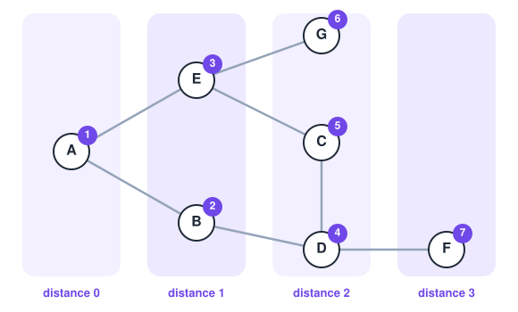

# Breadth-First Search (BFS)

> **Explore a graph in waves: the start, then everything 1 edge away, then everything 2 edges away, and so on.**
>
> Before reading this, I make sure Levels 0 to 2 of the [family course](../README.md) are clear, and the [level order](../../01_tree_traversal/04_level_order/) exercise is done: BFS is level order plus a visited set.

---

## 1. The intuition

A piece of news starts with one person. In the first hour, they tell all their friends. In the second hour, each of those friends tells their own friends who have not heard it yet. In the third hour, the next circle hears it, and so on.

If I write down **at which hour** each person heard the news, I get exactly the number of "friend of a friend of a…" steps between them and the first person. Nobody hears it later than necessary: the news always travels through the shortest chain.

That is BFS. It explores in **waves**, and the wave number of a vertex is its **distance** from the start.



From A: wave 0 is A; wave 1 is B and E; wave 2 is D, C and G; wave 3 is F. The purple numbers are the visit order: `A B E D C G F`.

---

## 2. The rule

BFS is the skeleton of the family course with a **queue** as the waiting line:

```text
bfs(graph, start):
    queue = a queue containing start
    visited = {start}
    order = []
    while the queue is not empty:
        vertex = take the front of the queue
        add vertex to order
        for each neighbour of vertex, in the order of its list:
            if neighbour is not in visited:
                add neighbour to visited
                add neighbour at the back of the queue
    return order
```

### An important detail: mark a vertex when it *enters* the queue

Notice that a vertex is added to `visited` **as soon as it is discovered**, when it enters the queue, and not later when it is taken out.

Why? Look at C in the figure: it is a neighbour of both E and D. If I only marked vertices when taking them out, E would put C in the queue, then D would put C in the queue **again** before C was taken out. C would wait in the line twice. On big graphs, the queue would fill up with duplicates.

Marking at discovery means: "someone already called this person, don't call them again".

---

## 3. Step by step

On `sample_graph()`, starting from A. Front of the queue on the left.

| Take | Neighbours (in list order) | Newly discovered | Queue after | Visited after |
| --- | --- | --- | --- | --- |
| | | | `[A]` | A |
| A | B, E | B, E | `[B, E]` | A B E |
| B | A, D | D | `[E, D]` | A B E D |
| E | A, C, G | C, G | `[D, C, G]` | A B E D C G |
| D | B, C, F | F (C is already known) | `[C, G, F]` | A B E D C G F |
| C | D, E | (none) | `[G, F]` | |
| G | E | (none) | `[F]` | |
| F | D | (none) | `[]` | |

Order: `A B E D C G F`.

---

## 4. From order to distances

A vertex discovered while handling `vertex` is exactly **one edge farther** than `vertex`. So:

```text
distance[start] = 0
when neighbour is discovered from vertex:
    distance[neighbour] = distance[vertex] + 1
```

On the sample graph: `{A: 0, B: 1, E: 1, D: 2, C: 2, G: 2, F: 3}`. The `distance` dictionary can even replace the `visited` set: "is in `distance`" means "already discovered".

---

## 5. From distances to the path itself

Knowing that F is 3 edges away is nice; knowing **which** 3 edges is better. The trick: every vertex remembers **who discovered it**. That is called its **parent**, like a signpost pointing back towards the start.

```text
parent[start] = nothing
when neighbour is discovered from vertex:
    parent[neighbour] = vertex
```

On the sample graph: `B ← A`, `E ← A`, `D ← B`, `C ← E`, `G ← E`, `F ← D`.

To get the path from A to F, I start at F and follow the signposts back: F → D → B → A. Then I **reverse** that list: `A B D F`.

If the goal was never discovered, there is no path: the answer is `None`.

### Why is it the shortest path?

Because of the waves. BFS finishes **all** vertices at distance 1 before touching any vertex at distance 2, and so on. So the first time a vertex is reached, it is from a vertex of the previous wave, through the smallest possible number of edges. No shorter route can arrive later, because shorter routes are explored first.

> **Limit.** "Shortest" here means **fewest edges**. If edges have different lengths (kilometres, minutes, prices), the path with fewer edges can be longer in total. For that, BFS is replaced by **Dijkstra's algorithm**, which uses a priority queue instead of a plain queue. It comes later in this repository.

---

## 6. Complexity

`V` is the number of vertices and `E` the number of edges.

| | Cost | Why |
| --- | --- | --- |
| Time | `O(V + E)` | Each vertex enters and leaves the queue once; each neighbour list is read once. |
| Memory | `O(V)` | The visited set, the queue, the distances and the parents hold at most `V` vertices each. |

As with level order, the queue must be a `collections.deque`: `list.pop(0)` would make BFS `O(V²)`.

---

## 7. Where BFS is used in real life

- **Social networks.** "People you may know" are your friends' friends: vertices at distance 2. LinkedIn literally shows "1st", "2nd", "3rd" next to each name: that is a BFS distance.
- **Fewest connections.** The route with the fewest changes in a metro network, the fewest hops between two computers on a network.
- **Puzzles and games.** Finding the shortest solution of a sliding puzzle or a Rubik's cube: each state of the puzzle is a vertex, each move is an edge, and BFS finds the solution with the fewest moves. Video game characters moving on a grid of squares use BFS (or its faster cousin A\*) to find their way.
- **Web crawlers.** Search engines explore the web starting from known pages, visiting the closest links first.
- **Garbage collection.** Cheney's algorithm, used by some memory managers, copies all the still-reachable objects with a BFS.
- **Broadcasting.** Spreading a message, an update, or a rumour through a network wave by wave.

---

## 8. Common mistakes

- **Marking visited when taking out instead of when discovering.** The answer stays correct, but vertices can enter the queue several times.
- **Forgetting the visited set.** On a graph with a cycle, BFS never stops.
- **`graph[vertex]` instead of `graph.get(vertex, [])`.** A vertex that only appears as someone's neighbour has no key of its own; `graph[vertex]` raises `KeyError`.
- **Forgetting to reverse the path** rebuilt from the parents: it comes out goal-first.

---

## 9. Checkpoint

1. Run BFS on `sample_graph()` from G. Give the order and the distances.
2. Rebuild the shortest path from G to B with the parents.
3. Why can BFS not be trusted to find the fastest driving route between two cities?

<details><summary>Answers</summary>

1. Order `G E A C B D F`. Distances: G 0, E 1, A 2, C 2, B 3, D 3, F 4.
2. Parents: `E ← G`, `A ← E`, `C ← E`, `B ← A`, `D ← C`, `F ← D`. From B: B → A → E → G, reversed: `G E A B`.
3. Roads have different lengths. BFS minimises the number of roads, not the total distance. That is the job of Dijkstra's algorithm.
</details>

---

## 10. Exercises

Open [bfs.py](bfs.py) and implement:

| Function | What it does |
| --- | --- |
| `bfs(graph, start)` | The visit order. |
| `bfs_distances(graph, start)` | The number of edges from `start` to every reachable vertex. |
| `shortest_path(graph, start, goal)` | A path with the fewest edges, or `None`. |

Then run, from the `Python/` folder:

```bash
pytest -k bfs
```
