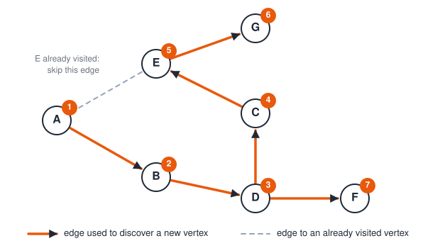

# Depth-First Search (DFS)

> **Follow one path as far as possible. At a dead end, step back to the last crossroads and try a way not taken yet.**
>
> Before reading this, I make sure Levels 0 to 2 of the [family course](../README.md) are clear, and the [preorder](../../01_tree_traversal/01_preorder/) exercise is done: DFS is preorder plus a visited set.

---

## 1. The intuition

I am in a maze with a ball of thread tied to the entrance, and a piece of chalk.

- At every crossroads, I take the **first corridor I have not marked yet**, mark it with chalk, and keep walking, unrolling the thread.
- When I reach a dead end, or a place where every corridor is already marked, I **roll the thread back** to the previous crossroads, and try its next unmarked corridor.
- When the thread is completely rolled back to the entrance and every corridor there is marked, I have seen the whole maze.

The thread is the path from the start to where I stand. The chalk is the visited set. Rolling the thread back is called **backtracking**.

That is DFS: always go **deeper** while possible, and only come back when stuck.



From A, DFS goes A → B → D → C → E → G: six vertices in a row, always moving forward. At G it is stuck, so it rolls back to E, then C, then D, where one corridor is still unmarked: F. Order: `A B D C E G F`.

The dashed edge A-E is never used: when E is reached (through C), A is already visited, and when A's turn comes to look at E, E is already visited.

---

## 2. The recursive version

Recursion is the most natural way to write DFS: the call stack **is** the thread. Each call is one step forward; each `return` is one step back.

```text
dfs(graph, start):
    visited = an empty set
    order = []

    explore(vertex):
        add vertex to visited
        add vertex to order
        for each neighbour of vertex, in the order of its list:
            if neighbour is not in visited:
                explore(neighbour)       # go deeper
        # the loop is over: every corridor from here is marked -> step back

    explore(start)
    return order
```

`explore` is a function defined inside `dfs`, so it can see `visited` and `order` without passing them around.

---

## 3. Step by step

On `sample_graph()`, starting from A. The "thread" column is the pile of unfinished calls: the current path from the start.

| Step | On | Looks at | Decision | Order so far | Thread |
| --- | --- | --- | --- | --- | --- |
| 1 | A | B | new: go deeper | `A` | A |
| 2 | B | A, D | A is visited, D is new: go deeper | `A B` | A B |
| 3 | D | B, C | B is visited, C is new: go deeper | `A B D` | A B D |
| 4 | C | D, E | D is visited, E is new: go deeper | `A B D C` | A B D C |
| 5 | E | A, C, G | A and C are visited, G is new: go deeper | `A B D C E` | A B D C E |
| 6 | G | E | visited: dead end, step back | `… E G` | A B D C E G |
| 7 | E | | no corridor left: step back | | A B D C E |
| 8 | C | | no corridor left: step back | | A B D C |
| 9 | D | F | F is new: go deeper | | A B D |
| 10 | F | D | visited: dead end, step back | `… G F` | A B D F |
| 11 | | | everything steps back to A, A has nothing left (E is visited) | `A B D C E G F` | |

---

## 4. The iterative version, and its trap

Recursion in Python is limited to about 1,000 nested calls. A path of 10,000 vertices crashes it. So, like for trees, I use my own stack.

```text
dfs_iterative(graph, start):
    stack = [start]
    visited = an empty set
    order = []
    while the stack is not empty:
        vertex = take the top of the stack
        if vertex is in visited: skip it         # it was pushed twice
        add vertex to visited
        add vertex to order
        for each neighbour of vertex, in REVERSED list order:
            if neighbour is not in visited:
                put neighbour on the stack
    return order
```

Two details make it give **exactly** the same order as the recursive version:

1. **Reversed order.** A stack gives back the last thing put in. To explore the *first* neighbour first, it must be pushed *last*. Same idea as pushing the right child before the left one in [iterative preorder](../../01_tree_traversal/01_preorder/).
2. **Mark a vertex when it is taken out, not when it is pushed.** This is the opposite of BFS, and it is the trap.

### Why not mark when pushing, like BFS?

Marking at push looks cleaner (no duplicates on the stack), but it changes the order. Try it on the sample graph: when A is handled, both B **and** E are pushed and marked. Later, when DFS arrives on C through B and D, it looks at E… which is already marked, even though nobody has actually walked there yet. So C cannot continue to E, and the result becomes `A B D C F E G`: that is not a depth-first order anymore.

Marking at take-out means: "a vertex counts as visited only once I have **really stepped into it**". The price is that a vertex can sit on the stack several times; the `if vertex is in visited: skip it` line throws away the extra copies.

Trace (top of the stack on the right):

| Take | Already visited? | Order so far | Push (reversed, unvisited only) | Stack after |
| --- | --- | --- | --- | --- |
| | | | | `[A]` |
| A | no | `A` | E, B | `[E, B]` |
| B | no | `A B` | D | `[E, D]` |
| D | no | `A B D` | F, C | `[E, F, C]` |
| C | no | `A B D C` | E | `[E, F, E]` |
| E | no | `A B D C E` | G | `[E, F, G]` |
| G | no | `… E G` | | `[E, F]` |
| F | no | `… G F` | | `[E]` |
| E | **yes: skip** | | | `[]` |

Result: `A B D C E G F`, identical to the recursive version.

---

## 5. Finding a path, and backtracking

To return the path from `start` to `goal` and not only the visit order, I keep the thread itself: a list of the vertices on the current path.

```text
find_path(graph, start, goal):
    visited = an empty set
    path = []

    explore(vertex):            # returns True if goal was found below vertex
        add vertex to visited
        add vertex at the end of path            # unroll the thread
        if vertex is goal: return True
        for each neighbour of vertex:
            if neighbour is not in visited:
                if explore(neighbour): return True   # found: stop everything
        remove the last vertex of path           # dead end: roll the thread back
        return False

    if explore(start): return path
    return None
```

This "add, try, remove if it failed" pattern is called **backtracking**. It is the core of every algorithm that searches through choices: Sudoku solvers, the N-Queens puzzle, maze solvers. They will come later in this repository.

### The path found is not always the shortest

From A to C, `find_path` answers `A B D C` (3 edges), because DFS dives through B first. But `A E C` only has 2 edges. DFS answers "is there a path, and here is one". For the **shortest** one (in number of edges), use [BFS](../01_bfs/).

---

## 6. Complexity

`V` is the number of vertices and `E` the number of edges.

| | Cost | Why |
| --- | --- | --- |
| Time | `O(V + E)` | Each vertex is entered once; each neighbour list is read once. In the iterative version a vertex can be pushed once per incoming edge, which stays within `O(E)`. |
| Memory | `O(V)` | The visited set holds up to `V` vertices. The thread (call stack or own stack) can be as long as `V` on a graph shaped like a long path. |

---

## 7. Where DFS is used in real life

- **Mazes.** Solving a maze is literally the thread-and-chalk method. Many maze *generators* also use DFS: they dig corridors randomly, deeper and deeper, and backtrack when stuck.
- **The "paint bucket" tool.** Clicking with the fill tool in an image editor spreads the colour to every connected pixel of the same colour. That is a traversal of the grid of pixels (often written as a DFS, a technique called *flood fill*).
- **Detecting loops.** Circular imports between Python files, circular references between spreadsheet cells (`A1 = B1 + 1`, `B1 = A1 * 2`), deadlocks between programs waiting for each other: all are cycles in a directed graph, found with a DFS.
- **Ordering tasks by their dependencies.** `pip`, `npm` and other package managers install the libraries a package depends on before the package itself; `make` compiles files in the right order; a university checks that course prerequisites can be followed. That is a **topological sort**, built on DFS.
- **Garbage collection.** "Mark and sweep" memory managers mark every object still reachable from the program, by following references with a DFS, then free everything unmarked.
- **Solving puzzles.** Sudoku, crosswords, the N-Queens problem: try a choice, go deeper, backtrack if it leads nowhere.

---

## 8. Common mistakes

- **Forgetting the visited set.** On the cycle A-B-D-C-E-A, DFS goes around forever (until `RecursionError`).
- **Marking at push in the iterative version.** The result is a valid traversal, but not the depth-first order.
- **Pushing neighbours in list order.** The last neighbour comes out first: a mirror order.
- **In `find_path`, not removing a vertex on a dead end.** The returned path then contains detours that are not connected to each other.

---

## 9. Checkpoint

1. Run DFS on `sample_graph()` from G. Give the order.
2. With the iterative version, which vertices end up on the stack twice when starting from A?
3. Give a situation where DFS is the better choice, and one where BFS is.

<details><summary>Answers</summary>

1. `G E A B D C F`. G → E → A → B → D → C (C's neighbours D and E are visited), back to D → F.
2. Only E: it is pushed by A and again by C before being visited. The copy pushed by A is skipped at the end.
3. DFS: detecting a cycle, ordering dependencies, solving a puzzle by trying choices, or a very wide graph where BFS's queue would use too much memory. BFS: the fewest steps between two vertices, distances in a social network.
</details>

---

## 10. Exercises

Open [dfs.py](dfs.py) and implement:

| Function | What it does |
| --- | --- |
| `dfs(graph, start)` | The visit order, recursive. |
| `dfs_iterative(graph, start)` | The same order with my own stack. Must handle a path of 10,000 vertices. |
| `find_path(graph, start, goal)` | The first path DFS finds, or `None`. |

Then run, from the `Python/` folder:

```bash
pytest -k dfs
```
