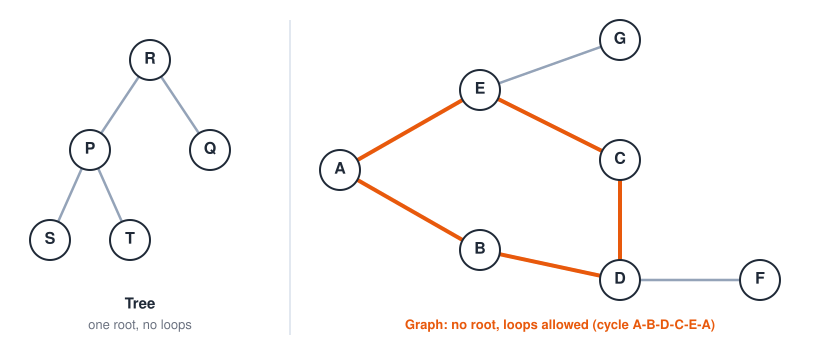
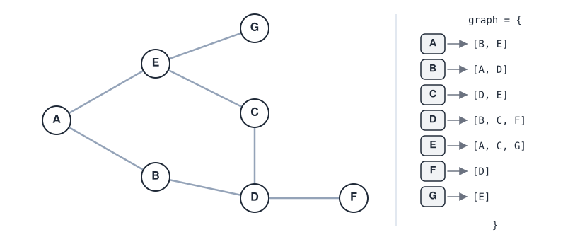
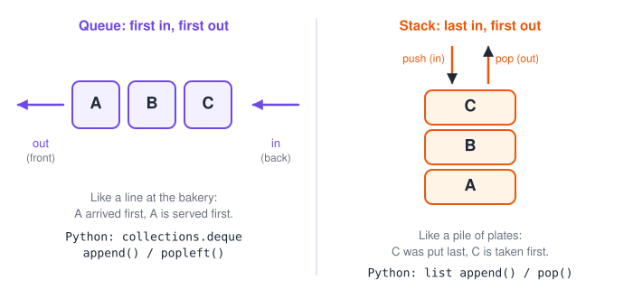

# Graph traversal: the complete course

This folder covers the two fundamental ways to explore a graph. Almost every graph algorithm in this repository (cycle detection, topological sort, Dijkstra, Prim, PERT…) is built on top of one of them.

| # | Algorithm | In one sentence |
| --- | --- | --- |
| 01 | [Breadth-First Search (BFS)](01_bfs/) | Explore in waves: everything 1 step away, then 2 steps away, and so on. |
| 02 | [Depth-First Search (DFS)](02_dfs/) | Follow one path as far as possible, then backtrack and try another. |

This page is the theory shared by both. It assumes the [tree traversal course](../01_tree_traversal/README.md) is done: a graph traversal is a tree traversal plus **one** new difficulty.

Like the tree course, it is a staircase of levels, each ending with a checkpoint.

---

## Level 0: What is a graph?

### Start with something I already know

Picture a metro map. There are **stations**, and **lines** between some of them. From any station I can go to the stations directly connected to it, and from there to others. There is no "top" station: I can start wherever I want. And I can ride in a loop and come back where I started.

Or picture a social network: people, and friendships between them. Or a road map: cities, and roads.

All three are **graphs**: a set of things, and links between some pairs of them.

### The vocabulary

- **Vertex** (plural *vertices*), also called a node: one thing (a station, a person, a city).
- **Edge**: a link between two vertices (a metro segment, a friendship, a road).
- **Neighbours**: the vertices directly linked to a given vertex.
- **Path**: a sequence of vertices where each one is linked to the next, like a metro trip.
- **Cycle**: a path that comes back to where it started.
- **Undirected** graph: every edge works both ways, like a friendship. **Directed** graph: every edge has a direction, like a one-way street, or "follows" on a social network (I can follow someone who doesn't follow me back). Directed edges are drawn as arrows.

### How is it different from a tree?



A tree is actually a very well-behaved graph: it has a root, and **no cycles**. In a tree, going down from the root, I can never arrive twice at the same node.

A general graph has **no root** and **can have cycles**: on the right, A → B → D → C → E → A goes around in a circle.

That cycle is the one new difficulty. If I explore a graph like a tree, blindly going to every neighbour, I will go around that cycle **forever**.

### The fix: remember where I have been

In the Greek myth, Theseus goes into the Labyrinth unrolling a ball of thread, so he knows which corridors he has already walked. Explorers of real caves mark the walls with chalk.

A graph traversal does the same: it keeps a **visited** set, and **never enters a vertex twice**. In Python, a `set` answers "have I been here?" in `O(1)` (constant time, whatever its size).

> **Checkpoint 0**
> 1. In the graph on the right, who are the neighbours of D?
> 2. Give a cycle different from A-B-D-C-E-A, or explain why there is none.
> 3. Why does a tree traversal not need a "visited" set?
>
> <details><summary>Answers</summary>
>
> 1. B, C and F.
> 2. There is none. Every other edge (E-G, D-F) leads to a dead end, so the only loop is A-B-D-C-E-A.
> 3. A tree has no cycles: going down from the root, every node is reached by exactly one path, so it can never be met twice.
> </details>

---

## Level 1: Storing a graph in memory

A drawing is for humans. The computer needs, for each vertex, the list of its neighbours. That is called an **adjacency list** ("adjacent" means "next to").



In Python, a dictionary is perfect: each vertex is a key, and its value is the list of its neighbours.

```python
graph = {
    "A": ["B", "E"],
    "B": ["A", "D"],
    ...
}
```

Because this graph is undirected, every edge is written twice: B is in A's list, and A is in B's list. In a directed graph, an edge from X to Y is written only in X's list.

The shared code is in [graph.py](graph.py), and `sample_graph()` builds the graph above. It is used in every figure and test of this family.

### The other way: the adjacency matrix

A graph can also be stored as a grid of `V × V` cells (`V` = number of vertices), with a 1 in row X, column Y when there is an edge from X to Y. Comparing the two (`E` = number of edges):

| | Adjacency list | Adjacency matrix |
| --- | --- | --- |
| Memory | `O(V + E)` | `O(V²)` |
| "Is there an edge X → Y?" | `O(number of neighbours of X)` | `O(1)` |
| "List the neighbours of X" | `O(number of neighbours of X)` | `O(V)`, the whole row |

Most real graphs are **sparse**: each vertex has few neighbours compared to the total (I have a few hundred friends, not a billion). For them, the list wins by far, and traversals only ever ask "list the neighbours of X". So this repository uses adjacency lists.

> **Checkpoint 1**
> 1. Write the adjacency list of a directed graph with the edges X → Y, Y → Z, X → Z.
> 2. A social network has 1 billion users with about 200 friends each. Why is a matrix a bad idea?
>
> <details><summary>Answers</summary>
>
> 1. `{"X": ["Y", "Z"], "Y": ["Z"], "Z": []}`.
> 2. It would need 10¹⁸ cells (a billion times a billion), almost all of them 0. The list only needs about 200 billion entries.
> </details>

---

## Level 2: Two strategies, one skeleton

Exactly like trees, there are two ways to explore: **breadth-first** and **depth-first**.

- **Breadth-First Search** (BFS): like ink dropped on paper, it spreads in **waves**. First all the neighbours of the start, then all *their* neighbours, and so on.
- **Depth-First Search** (DFS): like an explorer in a maze, it follows **one corridor** as far as it goes. At a dead end, it walks back to the last crossroads and tries a corridor it has not taken yet.

Here is the important part. Both are the **same algorithm**, with a different waiting line:

```text
explore(graph, start):
    waiting = a container holding start
    visited = an empty set
    while waiting is not empty:
        vertex = take one vertex out of waiting
        if vertex is in visited: skip it
        add vertex to visited
        handle vertex
        put each neighbour of vertex into waiting
```



- If `waiting` is a **queue** (first in, first out), the oldest discoveries are handled first: the closest vertices come out first. That is **BFS**.
- If `waiting` is a **stack** (last in, first out), the newest discovery is handled first: I keep following the latest vertex found, deeper and deeper. That is **DFS**.

It is the same idea as in the tree family: level order uses a queue, preorder uses a stack. In fact, **level order is BFS on a tree, and preorder is DFS on a tree**.

> **Checkpoint 2**
> 1. What single change turns BFS into DFS in the skeleton above?
> 2. Which tree traversal is BFS? Which one is DFS?
>
> <details><summary>Answers</summary>
>
> 1. Replacing the queue with a stack.
> 2. Level order is BFS. Preorder is DFS (inorder and postorder are DFS too, they only write the node at a different moment).
> </details>

---

## Level 3: How much does it cost?

Two numbers describe the size of a graph: `V`, the number of vertices, and `E`, the number of edges.

- Each vertex is **entered at most once**, thanks to the visited set: that is `V` steps.
- When a vertex is entered, its neighbour list is read once. Over the whole run, that reads every edge once (twice for an undirected graph, once from each end): that is `E` steps.

Total time: **`O(V + E)`**, read "order V plus E". It is the time needed just to read the graph, so it is the best possible.

Memory: the visited set and the waiting line hold at most every vertex: **`O(V)`**.

| | BFS | DFS |
| --- | --- | --- |
| Time | `O(V + E)` | `O(V + E)` |
| Memory | `O(V)` | `O(V)` |
| Waiting line | queue | stack (or the call stack, when recursive) |

So the two are equally fast. They differ by **the order** in which they visit, and that order decides what each one is good at.

---

## Level 4: What each one is good at

| I need to… | Use | Why |
| --- | --- | --- |
| find the path with the **fewest edges** | **BFS** | It reaches every vertex at distance 1 before distance 2: the first time it reaches a vertex, it is by a shortest path. |
| know the **distance** (in steps) to every vertex | **BFS** | Same reason. |
| know **whether** a path exists, any path | either | Both visit everything reachable. |
| detect **cycles**, order tasks by their **dependencies** | **DFS** | DFS knows which vertices are "on the current path", which reveals loops and dependency order. |
| explore **all possible choices** (puzzles, mazes) | **DFS** | It is the basis of *backtracking*: try a choice, go deep, undo it if it fails. |
| keep memory small on a very wide graph | **DFS** | It only keeps the current path, while BFS keeps a whole wave. |

### Where they are used in real life

- **BFS**: "people you may know" on social networks (friends of friends are 2 steps away), the fewest metro changes between two stations, web crawlers exploring the pages closest to a starting site, the shortest solution to a puzzle such as a Rubik's cube, broadcasting a message on a network.
- **DFS**: solving and generating mazes, the "paint bucket" fill tool in image editors, detecting circular imports or circular references in a spreadsheet, finding the order to install packages (`pip`, `npm`) or build files (`make`), the "mark" phase of garbage collectors (finding all the objects still reachable in memory).

### What comes next

Many later algorithms of this repository are BFS or DFS in disguise:

- **Cycle detection, connected components, topological sort, strongly connected components**: DFS with extra bookkeeping.
- **Dijkstra**: BFS where the queue is replaced by a priority queue, to handle edges with different lengths.
- **PERT and the critical path**: a topological sort (so a DFS) followed by a pass over the tasks.

---

## Exercises and how to work

Each algorithm folder contains its course (`README.md`), the functions to implement (`bfs.py`, `dfs.py`) and their tests. From the `Python/` folder:

```bash
pytest -k bfs
pytest -k dfs
```

Suggested order: **BFS → DFS**.
